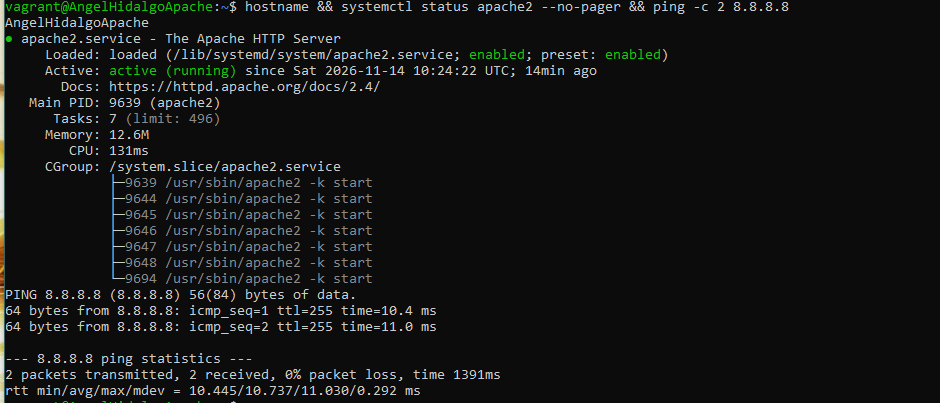
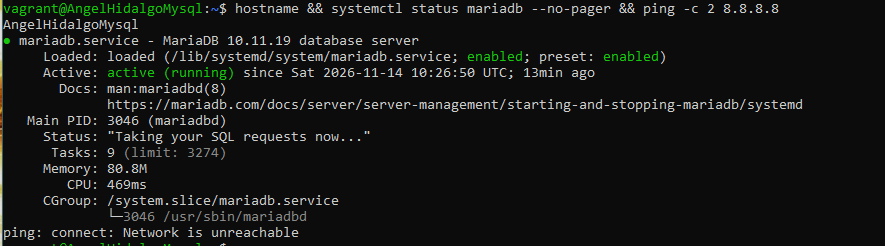
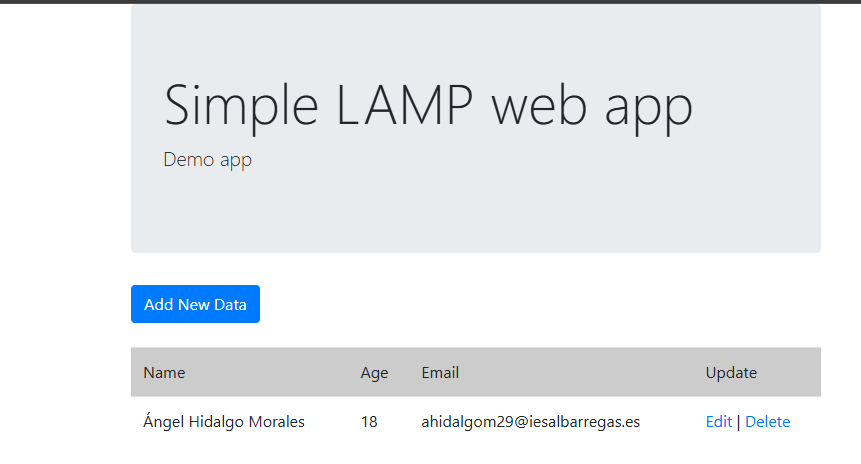

# Infraestructura en Dos Niveles con Vagrant (LAMP)

**Estudiante:** Ángel Hidalgo Morales  
**Curso:** 2º ASIR

## 1. Descripción de la Arquitectura

En esta práctica se ha desplegado una infraestructura web dividida en dos niveles sobre máquinas virtuales Debian 12 (`debian/bookworm64`) gestionadas con Vagrant:

* **Nivel 1 - Servidor Web (`AngelHidalgoApache`):** Máquina con interfaz NAT para salida a Internet (necesaria para instalar paquetes), conectada a una red privada (`192.168.56.10`) y con redirección de puertos (*Port Forwarding*) del puerto `80` interno al `8080` del equipo anfitrión.
* **Nivel 2 - Servidor de Base de Datos (`AngelHidalgoMysql`):** Máquina con MariaDB conectada únicamente a la red privada (`192.168.56.20`). Se ha eliminado su puerta de enlace por defecto para aislarla completamente de Internet.

---

## 2. Explicación de los Scripts de Aprovisionamiento

### A. `provision_apache.sh`

```bash
#!/bin/bash
apt-get update
apt-get install -y apache2 php libapache2-mod-php php-mysql
chown -R www-data:www-data /var/www/html/app
chmod -R 755 /var/www/html/app
systemctl restart apache2
systemctl enable apache2
```

* `apt-get update`: Actualiza la lista de paquetes disponibles en los repositorios de Debian 12.
* `apt-get install -y apache2 php libapache2-mod-php php-mysql`: Instala de forma desatendida el servidor web Apache, el intérprete de PHP, el módulo de integración entre ambos y el conector para comunicarse con MySQL/MariaDB.
* `chown -R www-data:www-data /var/www/html/app`: Asigna al usuario y grupo del servidor web (`www-data`) la propiedad de los archivos de la aplicación.
* `chmod -R 755 /var/www/html/app`: Establece permisos de lectura y ejecución para que Apache pueda servir los ficheros PHP correctamente.
* `systemctl restart apache2` y `systemctl enable apache2`: Reinicia el servicio para aplicar la carga de PHP y lo habilita para que arranque automáticamente con el sistema.

---

### B. `provision_mysql.sh`

```bash
#!/bin/bash
apt-get update
apt-get install -y mariadb-server
sed -i 's/127.0.0.1/0.0.0.0/g' /etc/mysql/mariadb.conf.d/50-server.cnf
systemctl restart mariadb
systemctl enable mariadb
mysql -e "CREATE DATABASE IF NOT EXISTS lamp_db CHARSET utf8mb4;"
mysql lamp_db < /tmp/app/db/database.sql
mysql -e "CREATE USER IF NOT EXISTS 'admin_web'@'192.168.56.10' IDENTIFIED BY '1234';"
mysql -e "GRANT ALL PRIVILEGES ON lamp_db.* TO 'admin_web'@'192.168.56.10';"
mysql -e "FLUSH PRIVILEGES;"
ip route del default
```

* `apt-get update` y `apt-get install -y mariadb-server`: Actualiza repositorios e instala el motor de base de datos MariaDB.
* `sed -i 's/127.0.0.1/0.0.0.0/g' /etc/mysql/mariadb.conf.d/50-server.cnf`: Modifica la dirección de escucha (`bind-address`) para que el servidor acepte conexiones externas desde la red privada y no solo desde `localhost`.
* `systemctl restart mariadb` y `systemctl enable mariadb`: Reinicia el gestor de base de datos para aplicar el cambio de red y lo activa en el inicio del sistema.
* `mysql -e "CREATE DATABASE IF NOT EXISTS lamp_db CHARSET utf8mb4;"`: Crea la base de datos `lamp_db` con codificación UTF-8.
* `mysql lamp_db < /tmp/app/db/database.sql`: Importa la estructura de la tabla `users` definida en el script SQL de la aplicación.
* `CREATE USER ...` y `GRANT ALL PRIVILEGES ...`: Crea el usuario `admin_web` restringido únicamente a la IP del servidor Apache (`192.168.56.10`) y le otorga permisos completos sobre `lamp_db`.
* `FLUSH PRIVILEGES;`: Recarga la tabla de privilegios para aplicar los permisos de inmediato.
* `ip route del default`: Elimina la ruta por defecto hacia la interfaz NAT, dejando la máquina sin ningún acceso a Internet.

---

## 3. Verificación del Entorno

### Servidor Apache (`AngelHidalgoApache`)
Se comprueba que el servicio `apache2` está activo y que la máquina dispone de salida a Internet:



### Servidor MySQL (`AngelHidalgoMysql`)
Se comprueba que `mariadb` está corriendo y que al hacer `ping` al exterior devuelve `Network is unreachable`, confirmando su aislamiento:



### Aplicación Web Desplegada
Acceso desde el navegador anfitrión mediante *Port Forwarding* (`http://localhost:8080/app/src/`):



---

## 4. Screencast de Funcionamiento

[Ver vídeo de demostración de la aplicación (demo.mp4)](demo.mp4)

